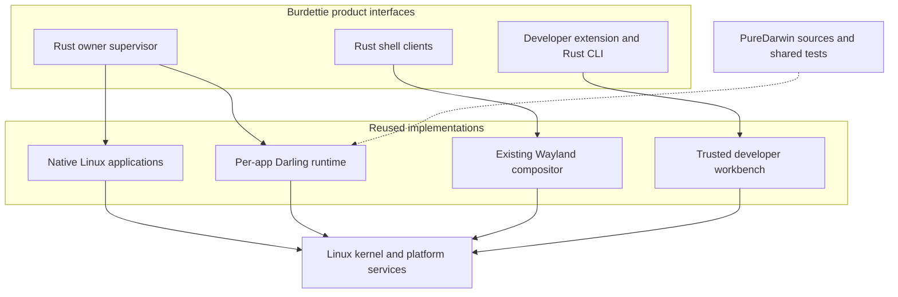

# Architecture research checkpoint — 2026-11-25

Linux is the product kernel. Rust owns Burdettie's policy/supervision bridges,
shell clients and product integrations. Existing open-source projects provide
the compatibility runtime, compositor, image tooling and developer workbench
when their behavior and contribution model fit.

[ADR 0003](../adr/0003-linux-foundation-and-upstream-reuse.md) settles that product
direction. [ADR 0004](../adr/0004-linux-integration-boundaries.md) accepts the
integration boundaries and experiment order developed in this checkpoint.
The named implementations below remain evaluation candidates.

## Proposed integration topology

The diagram shows integration responsibilities, not proof of confinement. Each
Darling domain includes its matched loader/libraries/server, prefix and process
tree. The trusted owner supervisor remains outside it. The developer workbench
uses separately declared developer authority. PureDarwin contributes selected
sources, toolchain work and tests; it is not a second kernel stacked under the
Linux product.

## Research records and outcomes

| Record | Executed evidence | Architecture effect |
| --- | --- | --- |
| [Darling runtime](2026-11-25-darling-runtime.md) | Eight upstream host programs compiled; six passed and two failed under observed environment restrictions. Five existing C fixtures passed native ELF source controls. | Complete current rootless core/system control before a Rust supervisor; coherent guest ABI; fixed initial corpus. No Mach-O runtime result yet. |
| [Linux enforcement](2026-11-25-linux-enforcement.md) | Child/grandchild seccomp denial; concrete writable/executable memfd alias counterexample; local unavailable/blocked mechanisms recorded. | Whole-runtime domain per app/profile; immutable admission, service mediation and activation order need qualification. |
| [PureDarwin reuse](2026-11-25-puredarwin-reuse.md) | Native libDER plain/sanitized runs each passed 28/30 with two semantic failures. Rendered SDK wrapper reproduced inconsistent path/version output. | SDK discovery fix and parser regressions are useful upstream candidates; parser trust adoption held. |
| [Desktop and developer tools](2026-11-25-linux-desktop-devtools.md) | Native C edit/build/run and diagnostics passed. mkosi parsed a prototype configuration; no image boot or IDE run. | Separate app windows, Rust shell clients and compositor; evaluate an existing workbench; preserve thread-affine GUI ownership. |
| [AWS host](2026-11-25-aws-host.md) | Selected Unix-socket, process-memory, namespace and Landlock prerequisites passed in the retained host's declared context. | Linux primitives exist beyond the restricted workspace. Current disk reserve blocked a runtime build; instance stopped with retained data intact. |

## Decisions and experiments

**Accepted boundaries:** Linux foundation; upstream reuse; Rust interfaces;
one application/profile runtime domain; external owner authority; coherent
guest ABI; GUI thread ownership; compositor/shell separation; reused developer
workbench and separate trusted developer route.

**Selected experiments:** current rootless Darling core/system control;
Debian 13/mkosi image; unmodified labwc plus Rust SCTK shell clients; Theia
workbench with a small Burdettie extension. None is a release adoption.

**Contribution candidates:** SDK discovery regression/fix, libDER contract and
encoding regressions, shared framework fixtures, and generally useful Rust
client/tool interfaces. The [upstream strategy](../UPSTREAM_STRATEGY.md) records
project-specific contribution policies. No upstream issue, message or PR was
sent in this investigation; acceptance of a particular change is unconfirmed.

**Still required:** complete Mach-O execution, a coherent Foundation workload,
two differently granted application domains with real negative operations,
an independently booted/recoverable session, IDE language/debugger workflows,
and an inventoried Apple application/version. The [research register](../RESEARCH_QUESTIONS.md)
and [M1 plan](../milestones/M1_PLATFORM_SECURITY.md) retain those gates.

## Reproduction and publication scope

Research runners live under [`scripts/research`](../../scripts/research).
Their reports distinguish completed probes, failed expectations, unavailable
mechanisms and unexecuted work. Raw output, binaries, imported applications,
private cloud identifiers and writable disks stay outside public source.
These curated records do not alter existing backend capability manifests,
contract schemas or historical M1 receipts.
